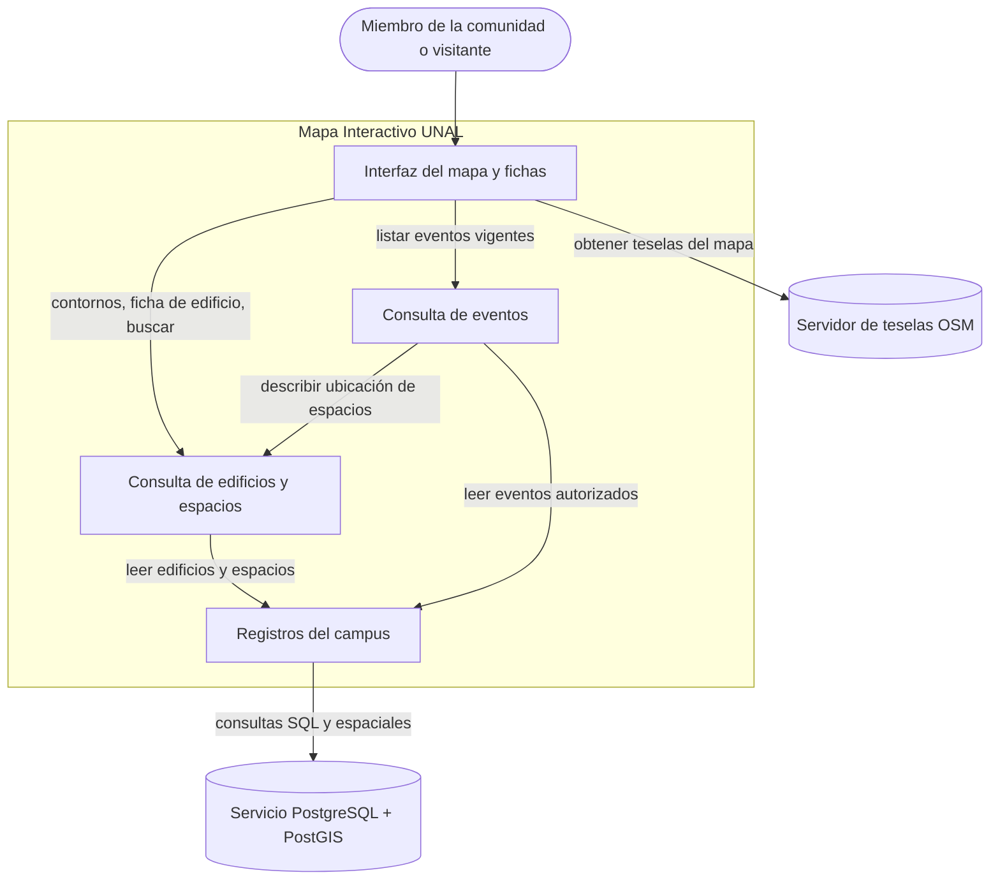
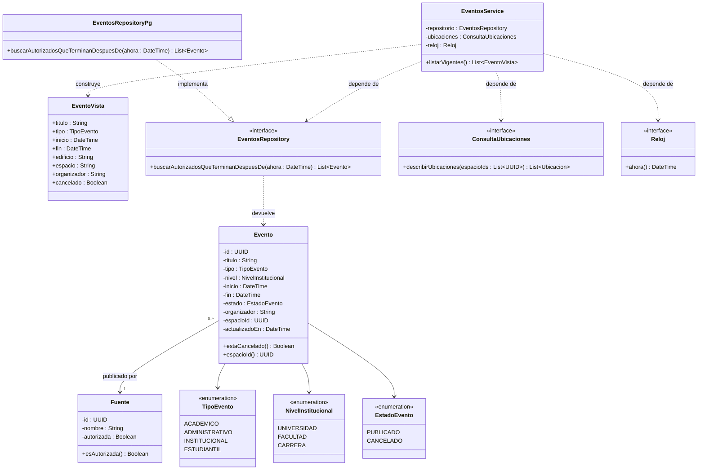
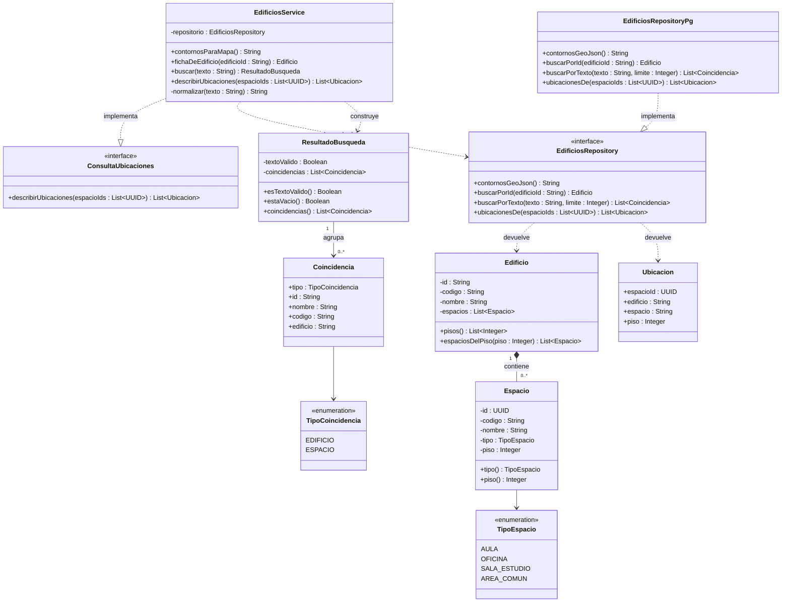

# Mapa Interactivo UNAL Sede Bogotá — Diseño Arquitectónico y Detallado v1.0

| | |
|---|---|
| **Equipo** | [Nombre del equipo] |
| **Integrantes** | [Nombre completo 1] · [Nombre completo 2] · [Nombre completo 3] · [Nombre completo 4] · [Nombre completo 5] |
| **Proyecto** | Mapa Interactivo UNAL Sede Bogotá |
| **Estado** | Listo para revisión |
| **Fecha** | 2026-10-19 |
| **Entradas** | `docs/requirements/REQ-01.md`, tabla de requerimientos del proyecto, Hipótesis Arquitectónica v0.1 (Clase 11), Diseño Detallado v0.1 (Clase 12) |

> **Nota sobre códigos.** REQ-01 y CU-01 son los códigos reales del repositorio. `REQ-MAPA` y `REQ-BUSQ`, y sus casos de uso `CU-MAPA` y `CU-BUSQ`, son provisionales. Se deben reemplazar por los códigos de la tabla de requerimientos del proyecto antes de entregar.

---

## 1. Visión General del Sistema y Motores del Diseño

**Propósito del sistema**
> Permitir que cualquier miembro de la comunidad de la UNAL sede Bogotá se ubique dentro del campus, encuentre los edificios y espacios que necesita y se entere de los eventos que ocurren en ellos desde un solo lugar.

**Requerimientos que dan forma a la estructura** *(los que más influyen en el diseño, no todos)*

| Requerimiento / Caso de uso | Por qué da forma a la estructura | Atributo de calidad, restricción o regla de negocio |
|---|---|---|
| REQ-MAPA / CU-MAPA Ver edificio en el mapa | Las geometrías de los edificios vienen de una fuente que no controlamos (OpenStreetMap) y requieren operaciones espaciales. Un solo componente debe ser dueño de esos datos. Al abrir un edificio, sus espacios se muestran agrupados por piso. | Restricción: geometrías de OSM y mapa Leaflet. Calidad: diseño responsive y uso del mapa con mala señal dentro de los edificios (teselas en caché de la PWA). |
| REQ-BUSQ / CU-BUSQ Buscar edificio o espacio | Busca sobre los mismos datos de edificios y espacios. Decide si la búsqueda es un componente aparte o una capacidad de la consulta de edificios. | Calidad: tiempo de respuesta de la búsqueda. Los usuarios buscan por nombre o por código (por ejemplo, "401"), con o sin tildes. |
| REQ-01 / CU-01 Consultar eventos vigentes | La consulta debe aplicar reglas de vigencia y fuente, y debe distinguir "no hay eventos" de "falló la carga". Además, cada evento ocurre en un espacio de un edificio. | RN-01 a RN-05. CA-01.5 frente a CA-01.6. Suposición: no requiere iniciar sesión. |

---

## 2. Diseño Arquitectónico

*(Hacia afuera: cuáles son las partes principales, de qué es responsable cada una y cómo interactúan.)*

### 2.1 Contexto y Frontera del Sistema

| Fuera del sistema | Tipo (actor / sistema externo / hardware) | Cómo interactúa el sistema con él |
|---|---|---|
| Miembro de la comunidad o visitante | Actor | Consulta el mapa, la ficha de cada edificio, la búsqueda y los eventos vigentes. No necesita iniciar sesión. |
| Servidor de teselas de OpenStreetMap | Sistema externo | La interfaz pide las imágenes base del mapa. No controlamos su disponibilidad. |
| Servicio gestionado PostgreSQL + PostGIS (Supabase) | Sistema externo | Almacena los datos. Controlamos el esquema, pero no el servicio ni su disponibilidad. |
| OpenStreetMap / Overpass | Sistema externo (solo en la carga inicial) | Un script del equipo importa una vez las geometrías de los edificios (ver Decisión A). **No** participa del sistema en ejecución, por eso no aparece en el diagrama de componentes. |

*(Una **ficha** es el panel de detalle que se abre al hacer clic en un edificio del mapa: nombre, código y espacios agrupados por piso. En celular se muestra como hoja inferior y en escritorio como panel lateral.)*

### 2.2 Componentes, Responsabilidades y Capacidades

Cubre el alcance funcional principal: mapa, edificios y búsqueda, y consulta de eventos (REQ-01).



*(Todo lo que está dentro de `SYS` lo construimos y controlamos. La Interfaz se despliega como PWA en React + Leaflet. Los demás componentes son módulos del backend NestJS. Esta correspondencia con la tecnología es de despliegue: los componentes se nombran por responsabilidad.)*

| Componente | Responsabilidad principal | Requerimientos / casos de uso | Capacidades provistas | Capacidades requeridas | Dependencias principales |
|---|---|---|---|---|---|
| Interfaz del mapa y fichas | Muestra el mapa, las fichas, la búsqueda y los eventos, y traduce los resultados (vacío, texto inválido, error) en mensajes al usuario. | REQ-MAPA, REQ-BUSQ, REQ-01 | Presentar la información al usuario y recoger sus acciones. | Teselas; contornos, ficha y búsqueda; eventos vigentes. | Consulta de edificios y espacios, Consulta de eventos, Servidor de teselas |
| Consulta de edificios y espacios | Es dueña de los edificios y espacios: contornos en GeoJSON para el mapa, ficha con los espacios agrupados por piso, búsqueda por nombre o código y descripción de ubicaciones para otros componentes. | REQ-MAPA, REQ-BUSQ, REQ-01 (ubicación) | Contornos para el mapa, ficha de edificio, buscar, describir ubicación de espacios. | Leer edificios y espacios. | Registros del campus |
| Consulta de eventos | Entrega los eventos vigentes de fuentes autorizadas en orden cronológico, con los cancelados marcados, y distingue la lista vacía del fallo de carga. | REQ-01 / CU-01 | Listar eventos vigentes. | Leer eventos autorizados, describir ubicación de espacios, hora actual. | Registros del campus, Consulta de edificios y espacios |
| Registros del campus | Persiste y recupera edificios, espacios y eventos, y oculta el esquema, el SQL y las funciones de PostGIS. | Todos | Leer edificios y espacios, leer eventos autorizados. | Consultas SQL y espaciales (externo). | Servicio PostgreSQL + PostGIS |

*Revisión: ningún componente lleva el nombre de una tecnología. La búsqueda **no** es un componente aparte, porque opera sobre los mismos datos que la consulta de edificios y espacios y no tiene reglas propias. Separarla solo habría agregado una flecha.*

---

## 3. Diseño Detallado

*(Hacia adentro: cómo se diseña internamente cada componente seleccionado.)*

### 3.1 Componentes seleccionados

| Componente | Por qué se seleccionó (riesgo, complejidad, centralidad en los motores) |
|---|---|
| Consulta de eventos | Es la continuación del Diseño Detallado v0.1 (Clase 12). Concentra cinco reglas de negocio (RN-01 a RN-05) y debe separar dos resultados que el usuario ve distinto: lista vacía (CA-01.5) y fallo de carga (CA-01.6). |
| Consulta de edificios y espacios | Es el componente más central del sistema: sostiene el mapa y la búsqueda (el MVP del proyecto) y provee a Consulta de eventos la ubicación de cada espacio. Si su diseño interno se filtra hacia otros componentes, cualquier cambio en los datos del campus se propaga a todo el sistema. |

*Los dos componentes restantes no se detallan: la Interfaz solo presenta lo que estos le entregan, y Registros del campus solo implementa los contratos de repositorio que aparecen en ambos diagramas.*

### 3.2 Diagramas de Clases

#### 3.2.1 Consulta de eventos



*(`Evento` → `Fuente` es una asociación y no una composición, porque una fuente existe y publica muchos eventos aunque uno se elimine. No se usa generalización: los cuatro tipos de evento se comportan igual en este requerimiento, así que basta con un enumerado. La realización del repositorio se justifica porque permite probar `EventosService` con un repositorio falso y un reloj fijo, como exige CA-01.3. `ConsultaUbicaciones` es el contrato que provee Consulta de edificios y espacios (ver 3.2.2).)*

#### 3.2.2 Consulta de edificios y espacios



*(`Edificio` → `Espacio` es composición porque un aula o una sala no existe fuera de su edificio: si el edificio se retira del sistema, sus espacios también. La multiplicidad es `0..*` porque un edificio importado de OSM puede no tener aún espacios cargados. No hay generalización entre edificio y espacio: no comparten comportamiento, solo el hecho de poder buscarse, y eso lo resuelve `Coincidencia` con un enumerado. Tampoco hay clase `Piso` (ver Decisión B).)*

### 3.3 Responsabilidades de las Clases

| Clase | Componente al que pertenece | Responsabilidad | Colaboradores clave |
|---|---|---|---|
| EventosService | Consulta de eventos | Pide los eventos vigentes autorizados, les añade la ubicación y los entrega ordenados y con los cancelados marcados. Deja propagar el fallo de datos para que la interfaz muestre "Reintentar". | EventosRepository, ConsultaUbicaciones, Reloj |
| Evento | Consulta de eventos | Representa un evento y sabe si está cancelado (RN-04). | Fuente |
| Fuente | Consulta de eventos | Representa a quien publica el evento y si está autorizado (RN-01). | ninguno |
| EventoVista | Consulta de eventos | Lleva solo los datos que pide CA-01.1, sin exponer la entidad. | ninguno |
| EventosRepository | Consulta de eventos (contrato) | Define qué eventos se piden: autorizados, que terminan después de `ahora`, ordenados por inicio (RN-01, RN-02, RN-03). | Evento |
| Reloj | Consulta de eventos (contrato) | Entrega la hora actual, para poder fijarla en las pruebas. | ninguno |
| TipoEvento, NivelInstitucional, EstadoEvento | Consulta de eventos | Valores cerrados del evento. | ninguno |
| EdificiosService | Consulta de edificios y espacios | Entrega los contornos para el mapa y la ficha de un edificio, normaliza y valida el texto de búsqueda y ordena los resultados. Además implementa el contrato que usa Consulta de eventos. | EdificiosRepository |
| Edificio | Consulta de edificios y espacios | Conoce sus espacios y sabe agruparlos por piso para la ficha. Nadie de afuera modifica su lista de espacios. | Espacio |
| Espacio | Consulta de edificios y espacios | Representa un aula, oficina, sala de estudio o área común, con su tipo y piso. | TipoEspacio |
| ResultadoBusqueda | Consulta de edificios y espacios | Distingue un texto inválido de una búsqueda válida sin coincidencias, para que la interfaz muestre el mensaje correcto. | Coincidencia |
| Coincidencia | Consulta de edificios y espacios | Describe un edificio o espacio encontrado, con el nombre de su edificio para mostrarlo en la lista. | TipoCoincidencia |
| Ubicacion | Consulta de edificios y espacios | Lleva la descripción legible de dónde está un espacio (edificio, espacio y piso). | ninguno |
| ConsultaUbicaciones | Consulta de edificios y espacios (contrato provisto) | Describe varios espacios en una sola llamada. Lo usa Consulta de eventos. | Ubicacion |
| EdificiosRepository | Consulta de edificios y espacios (contrato) | Define cómo se leen edificios, espacios y coincidencias, sin revelar el esquema ni PostGIS. | Edificio, Ubicacion, Coincidencia |
| TipoEspacio, TipoCoincidencia | Consulta de edificios y espacios | Valores cerrados de espacios y resultados de búsqueda. | ninguno |
| EventosRepositoryPg, EdificiosRepositoryPg | Registros del campus | Implementan los contratos con SQL sobre PostgreSQL + PostGIS. `EdificiosRepositoryPg` convierte las geometrías a GeoJSON con `ST_AsGeoJSON`. | Servicio PostgreSQL + PostGIS |

### 3.4 Comportamiento de una operación clave

`EdificiosService.buscar` sostiene REQ-BUSQ y debe separar tres resultados que el usuario ve distinto: texto inválido, sin coincidencias y fallo de carga.

```text
buscar(texto):
    t = normalizar(texto)            // minúsculas, sin tildes, sin espacios al inicio ni al final
    SI longitud(t) < 2:
        RETORNAR ResultadoBusqueda(textoValido = falso, coincidencias = [])
    INTENTAR coincidencias = repositorio.buscarPorTexto(t, LIMITE_RESULTADOS)
    SI falla la base:
        PROPAGAR error                // la interfaz muestra "No pudimos buscar" y "Reintentar"
    ordenar coincidencias:
        primero las que coinciden exactamente con un código (ej. "401"),
        luego los edificios, luego los espacios, y dentro de cada grupo por nombre
    RETORNAR ResultadoBusqueda(textoValido = verdadero, coincidencias)
        // si la lista está vacía, la interfaz muestra "No encontramos ese lugar";
        // no es un error
```

---

## 4. Calidad del Diseño — Cohesión, Acoplamiento y Ocultamiento de Información

| Pregunta | Nuestra respuesta, con evidencia del diseño |
|---|---|
| **Cohesión:** ¿las responsabilidades dentro de cada clase o componente van juntas? | Cada componente es dueño de un tipo de dato y de sus reglas: Consulta de edificios y espacios, de los datos físicos del campus, y Consulta de eventos, de las reglas RN-01 a RN-05. Dentro de Consulta de edificios, `Edificio` sabe agrupar sus espacios por piso, `ResultadoBusqueda` solo distingue los resultados posibles, y la normalización del texto vive en un único método privado. La búsqueda queda dentro de este componente porque usa exactamente sus mismos datos. |
| **Acoplamiento:** ¿hasta dónde se propaga un cambio? ¿Dónde están las dependencias más fuertes? | La dependencia externa más fuerte es OpenStreetMap, de donde vienen las geometrías. La contuvimos importándolas una sola vez (Decisión A), así que un cambio o una caída de OSM no llega al sistema en ejecución. La segunda es el esquema de la base, contenida en Registros del campus: los servicios solo conocen interfaces de repositorio. Entre componentes, la única dependencia es la de Consulta de eventos hacia Consulta de edificios y espacios, y pasa por un contrato pequeño (`ConsultaUbicaciones`) que devuelve datos simples, no entidades. Si `Edificio` o `Espacio` cambian, Consulta de eventos no se entera. |
| **Ocultamiento de información:** ¿qué se mantuvo privado o interno, y por qué? | El SQL, el esquema, las funciones de PostGIS y la conversión a GeoJSON quedan dentro de Registros del campus. La lista de espacios de `Edificio` es privada: solo se lee por piso con `pisos()` y `espaciosDelPiso()`. La regla de normalización de la búsqueda es un método privado de `EdificiosService`. Ni el campo `autorizada` de una fuente ni la entidad `Evento` viajan a la interfaz: `EventoVista` lleva solo los datos de CA-01.1. |

**Hallazgos reales en nuestro diseño y qué cambiamos**
> **1. Acoplamiento entre Eventos y el almacenamiento de edificios.** En el Diseño Detallado v0.1, `EventosRepositoryPg` hacía un JOIN directo con las tablas `espacios` y `edificios` para obtener el nombre del lugar. Eso hacía que Consulta de eventos dependiera de cómo se guardan los edificios: si cambiaba la estructura de espacios (por ejemplo, para agrupar por piso), se rompía la consulta de eventos. Lo cambiamos: `Evento` guarda solo `espacioId`, y `EventosService` pide las ubicaciones a Consulta de edificios y espacios mediante `ConsultaUbicaciones`. El método recibe una lista de identificadores para no hacer una llamada por evento. El costo es un paso más en la consulta, en vez de un solo JOIN.
>
> **2. Regla de vigencia duplicada (cohesión).** En v0.1, RN-02 vivía en dos lugares: en el método `Evento.estaVigente(ahora)` y en el filtro `fecha_fin > $1` de la consulta SQL. Si una cambiaba y la otra no, la lista y las pruebas se contradecían. Dejamos la regla en un solo lugar, que es el contrato `buscarAutorizadosQueTerminanDespuesDe(ahora)`. El nombre del método la hace explícita. `estaVigente` se eliminó de `Evento`, y CA-01.3 se prueba con un `Reloj` fijo contra ese contrato.

---

## 5. Decisiones de Diseño y Registro de Decisiones

### Decisión A — Arquitectónica

| | |
|---|---|
| **Contexto** (requerimiento, restricción o problema que la motivó) | REQ-MAPA necesita los contornos de los edificios, y la fuente es OpenStreetMap a través de la API de Overpass, que no controlamos: puede caerse, limitar peticiones o cambiar el formato de sus respuestas. Además, ni los espacios interiores ni algunos códigos de edificio están en OSM, y el mapa debe funcionar con mala señal dentro del campus. |
| **Decisión** | Porque la fuente de las geometrías es externa y no controlamos su disponibilidad, elegimos importarlas una sola vez con un script del equipo a nuestra propia base (Registros del campus). El sistema en ejecución nunca llama a Overpass. |
| **Justificación** (por qué es razonable aquí) | El mapa sigue funcionando aunque Overpass no responda. Las consultas espaciales se hacen con PostGIS sobre datos propios, y a esas geometrías les podemos asociar los espacios y códigos que OSM no tiene. Un cambio de formato en Overpass solo afecta al script de importación. |
| **Costo aceptado** | Aceptamos que nuestros datos se desactualicen: si alguien corrige o agrega un edificio en OSM, el sistema no se entera hasta que el equipo vuelva a ejecutar el script, lo cual es una tarea manual con un responsable. Además, las correcciones que hagamos en nuestra base no vuelven a OSM. Descartamos consultar Overpass en cada petición, porque una caída suya dejaría el mapa en blanco. |

### Decisión B — Diseño detallado

| | |
|---|---|
| **Contexto** | La ficha de un edificio debe mostrar sus espacios agrupados por piso (REQ-MAPA). Hoy un piso no tiene datos propios: no hay planos, nombres ni horarios por piso, solo un número. |
| **Decisión** | Porque un piso no tiene datos ni comportamiento propios, elegimos no crear una clase `Piso`. El piso es un atributo entero de `Espacio`, y `Edificio` ofrece `pisos()` y `espaciosDelPiso(piso)` para agrupar. Los sótanos se representan con números negativos. |
| **Justificación** | Evita una clase y una tabla que solo guardarían un número, y una composición de tres niveles (edificio, piso, espacio) que haría más difícil leer y cargar los datos. La agrupación queda en un único lugar, dentro de `Edificio`. |
| **Costo aceptado** | Si más adelante se necesitan planos por piso, o nombres que no son números (como "Mezzanine"), habrá que introducir la clase `Piso` y migrar los datos de `Espacio`. Además, cada vez que se arma la ficha se agrupa en memoria, en vez de leer los pisos ya agrupados. |

### ADR

**Archivo ADR:** `docs/decisions/ADR-001-importar-geometrias-de-osm.md`, que registra la Decisión A.

---

## 6. Trazabilidad

| Requerimiento | Caso de uso | Componente(s) | Clase(s) |
|---|---|---|---|
| REQ-MAPA | CU-MAPA Ver edificio en el mapa | Interfaz del mapa y fichas, Consulta de edificios y espacios, Registros del campus | EdificiosService, Edificio, Espacio, TipoEspacio, EdificiosRepository, EdificiosRepositoryPg |
| REQ-BUSQ | CU-BUSQ Buscar edificio o espacio | Interfaz del mapa y fichas, Consulta de edificios y espacios, Registros del campus | EdificiosService, ResultadoBusqueda, Coincidencia, TipoCoincidencia, EdificiosRepository, EdificiosRepositoryPg |
| REQ-01 | CU-01 Consultar eventos vigentes | Interfaz del mapa y fichas, Consulta de eventos, Consulta de edificios y espacios, Registros del campus | EventosService, Evento, Fuente, EventoVista, EventosRepository, EventosRepositoryPg, Reloj, TipoEvento, NivelInstitucional, EstadoEvento, ConsultaUbicaciones, Ubicacion |

**Suposiciones y preguntas abiertas que afectan el diseño**

- *Suposición:* los pisos se identifican con números enteros, y los sótanos con negativos (ver Decisión B).
- *Suposición:* un integrante del equipo es responsable de volver a ejecutar la importación de OSM cuando se detecten cambios en los edificios (ver Decisión A).
- *Pregunta abierta:* ¿cuántos resultados debe mostrar la búsqueda como máximo (`LIMITE_RESULTADOS`)?
- *Pregunta abierta:* ¿cada cuánto se revisa si OSM tiene cambios en los edificios del campus?

---

## 7. Opcional — Reflexión sobre el diseño asistido por IA

> Al planear la migración a Supabase, un asistente de IA propuso que el frontend consultara la base directamente con `supabase-js` y la API generada automáticamente, sin backend propio. Rechazamos esa propuesta, y el propio asistente la corrigió después: con el navegador hablando con la base, la credencial de acceso viaja al cliente, y cualquiera podría saltarse reglas como RN-01 (solo eventos de fuentes autorizadas) llamando a la API a mano. Por eso todos los componentes, salvo la Interfaz, viven en un backend propio, y Registros del campus es el único que habla con la base.

---

## 8. Lista de Verificación de Consistencia

- [x] Cada componente del diagrama aparece en la tabla de responsabilidades, y viceversa.
- [x] Cada clase pertenece a un componente identificable.
- [x] Los componentes se nombran por responsabilidad, no por tecnología.
- [x] Nada dentro de la frontera del sistema es algo que no controlamos.
- [x] Las capacidades provistas y requeridas coinciden entre componentes (lo que uno requiere, otro lo provee).
- [x] Ambas decisiones nombran un costo o limitación real, y al menos una tiene ADR.
- [x] La tabla de trazabilidad no tiene filas vacías ni componentes o clases huérfanos.
- [ ] Los diagramas se muestran correctamente en GitHub *(verificar después del push)*.
