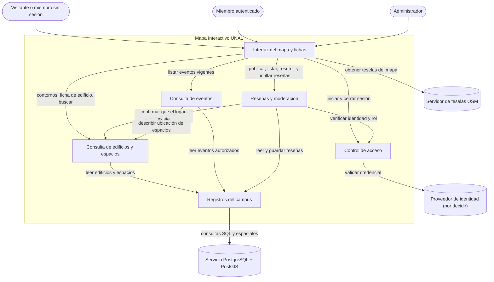
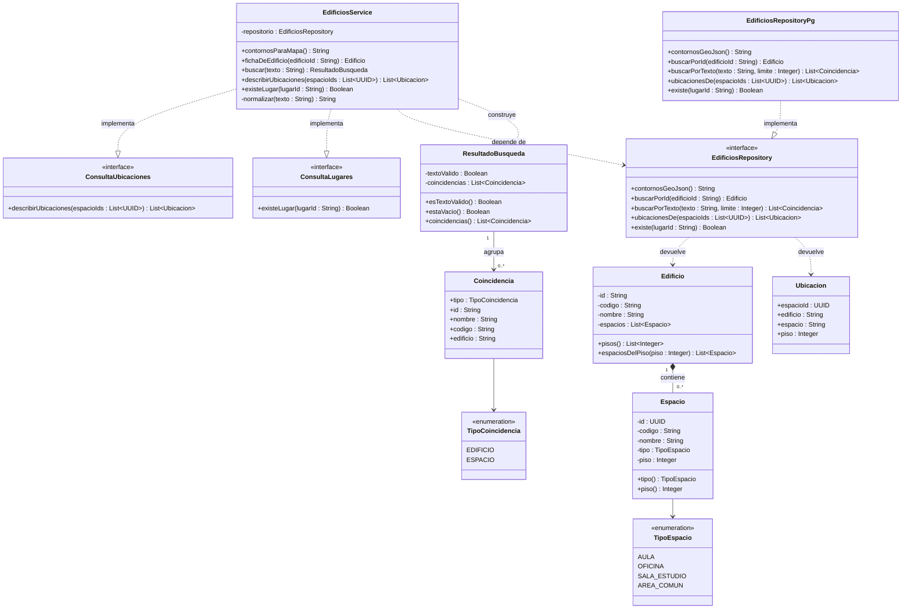

# Mapa Interactivo UNAL Sede Bogotá — Diseño Arquitectónico y Detallado v1.0

| | |
|---|---|
| **Equipo** | [Nombre del equipo] |
| **Integrantes** | [Nombre completo 1] · [Nombre completo 2] · [Nombre completo 3] · [Nombre completo 4] · [Nombre completo 5] |
| **Proyecto** | Mapa Interactivo UNAL Sede Bogotá |
| **Estado** | Listo para revisión |
| **Fecha** | 2026-10-19 |
| **Entradas** | `docs/requirements/REQ-01.md`, tabla de requerimientos del proyecto, Hipótesis Arquitectónica v0.1 (Clase 11), Diseño Detallado v0.1 (Clase 12) |

> **Nota sobre códigos.** REQ-01 y CU-01 son los códigos reales del repositorio. `REQ-MAPA`, `REQ-BUSQ`, `REQ-RESE` y `REQ-MODE`, y sus casos de uso `CU-MAPA`, `CU-BUSQ`, `CU-RESE` y `CU-MODE`, son provisionales. Se deben reemplazar por los códigos de la tabla de requerimientos del proyecto antes de entregar.

---

## 1. Visión General del Sistema y Motores del Diseño

**Propósito del sistema**
> Permitir que cualquier miembro de la comunidad de la UNAL sede Bogotá se ubique dentro del campus, encuentre los edificios y espacios que necesita y se entere de los eventos que ocurren en ellos desde un solo lugar. Además, el sistema debe permitir que los miembros con correo institucional opinen sobre esos lugares, bajo moderación, para que la información sea útil y confiable.

**Requerimientos que dan forma a la estructura** *(los que más influyen en el diseño, no todos)*

| Requerimiento / Caso de uso | Por qué da forma a la estructura | Atributo de calidad, restricción o regla de negocio |
|---|---|---|
| REQ-MAPA / CU-MAPA Ver edificio en el mapa | Las geometrías de los edificios vienen de una fuente que no controlamos (OpenStreetMap) y requieren operaciones espaciales. Un solo componente debe ser dueño de esos datos. Al abrir un edificio, sus espacios se muestran agrupados por piso. | Restricción: geometrías de OSM y mapa Leaflet. Calidad: diseño responsive y uso del mapa con mala señal dentro de los edificios (teselas en caché de la PWA). |
| REQ-BUSQ / CU-BUSQ Buscar edificio o espacio | Busca sobre los mismos datos de edificios y espacios. Decide si la búsqueda es un componente aparte o una capacidad de la consulta de edificios. | Calidad: tiempo de respuesta de la búsqueda. Los usuarios buscan por nombre o por código (por ejemplo, "401"), con o sin tildes. |
| REQ-01 / CU-01 Consultar eventos vigentes | La consulta debe aplicar reglas de vigencia y fuente, y debe distinguir "no hay eventos" de "falló la carga". Además, cada evento ocurre en un espacio de un edificio. | RN-01 a RN-05. CA-01.5 frente a CA-01.6. Suposición: no requiere iniciar sesión. |
| REQ-RESE / CU-RESE Publicar reseña de un lugar | Exige saber quién escribe y verificar que sea de la comunidad, pero el mecanismo de autenticación **aún no está decidido**. | Regla propuesta: solo correos `@unal.edu.co` y una reseña por usuario y lugar. Restricción: proveedor de identidad por definir. |
| REQ-MODE / CU-MODE Moderar reseñas | El administrador oculta contenido. Las reglas de visibilidad no pueden saltarse llamando directamente a los datos. | Calidad: integridad y confiabilidad del contenido. |

---

## 2. Diseño Arquitectónico

*(Hacia afuera: cuáles son las partes principales, de qué es responsable cada una y cómo interactúan.)*

### 2.1 Contexto y Frontera del Sistema

| Fuera del sistema | Tipo (actor / sistema externo / hardware) | Cómo interactúa el sistema con él |
|---|---|---|
| Visitante o miembro sin sesión | Actor | Consulta el mapa, las fichas de edificios, la búsqueda, los eventos y las reseñas visibles. |
| Miembro autenticado (`@unal.edu.co`) | Actor | Hace todo lo anterior y además publica reseñas. |
| Administrador | Actor | Oculta reseñas (moderación). El registro de eventos que también le corresponde está fuera del alcance de esta entrega (ver REQ-01, sección de alcance). |
| Servidor de teselas de OpenStreetMap | Sistema externo | La interfaz pide las imágenes base del mapa. No controlamos su disponibilidad. |
| Proveedor de identidad (**por decidir**: Supabase Auth o JWT propio) | Sistema externo | Emite y valida las credenciales de sesión. Solo el componente de Control de acceso habla con él (ver Decisión A). |
| Servicio gestionado PostgreSQL + PostGIS (Supabase) | Sistema externo | Almacena los datos. Controlamos el esquema, pero no el servicio ni su disponibilidad. |
| OpenStreetMap / Overpass | Sistema externo (solo en la carga inicial) | Un script del equipo importa una vez las geometrías de los edificios. **No** participa del sistema en ejecución, por eso no aparece en el diagrama de componentes. |

*(Una **ficha** es el panel de detalle que se abre al hacer clic en un edificio del mapa: nombre y código, espacios agrupados por piso, eventos próximos y reseñas. En celular se muestra como hoja inferior y en escritorio como panel lateral.)*

### 2.2 Componentes, Responsabilidades y Capacidades

Cubre el alcance funcional principal: mapa, edificios y búsqueda; consulta de eventos (REQ-01); y reseñas con moderación.



*(Todo lo que está dentro de `SYS` lo construimos y controlamos. La Interfaz se despliega como PWA en React + Leaflet. Los demás componentes son módulos del backend NestJS. Esta correspondencia con la tecnología es de despliegue: los componentes se nombran por responsabilidad.)*

| Componente | Responsabilidad principal | Requerimientos / casos de uso | Capacidades provistas | Capacidades requeridas | Dependencias principales |
|---|---|---|---|---|---|
| Interfaz del mapa y fichas | Muestra el mapa, las fichas, la búsqueda, los eventos y las reseñas, y traduce los resultados (vacío, error, rechazo) en mensajes al usuario. | REQ-MAPA, REQ-BUSQ, REQ-01, REQ-RESE, REQ-MODE | Presentar la información al usuario y recoger sus acciones. | Teselas; contornos, ficha y búsqueda; eventos vigentes; operaciones de reseñas; inicio de sesión. | Consulta de edificios y espacios, Consulta de eventos, Reseñas y moderación, Control de acceso, Servidor de teselas |
| Consulta de edificios y espacios | Es dueña de los edificios y espacios: contornos en GeoJSON para el mapa, ficha con los espacios agrupados por piso, búsqueda por nombre o código y descripción de ubicaciones para otros componentes. | REQ-MAPA, REQ-BUSQ, REQ-01 (ubicación), REQ-RESE (existencia del lugar) | Contornos para el mapa, ficha de edificio, buscar, describir ubicación de espacios, confirmar que un lugar existe. | Leer edificios y espacios. | Registros del campus |
| Consulta de eventos | Entrega los eventos vigentes de fuentes autorizadas en orden cronológico, con los cancelados marcados, y distingue la lista vacía del fallo de carga. | REQ-01 / CU-01 | Listar eventos vigentes. | Leer eventos autorizados, describir ubicación de espacios, hora actual. | Registros del campus, Consulta de edificios y espacios |
| Reseñas y moderación | Aplica las reglas de las reseñas (quién puede publicar, una por lugar, calificación válida), calcula el resumen de calificaciones visibles y oculta reseñas a pedido de un administrador. | REQ-RESE / CU-RESE, REQ-MODE / CU-MODE | Publicar, listar visibles, resumir calificaciones, ocultar reseña. | Verificar identidad y rol, confirmar que el lugar existe, leer y guardar reseñas. | Control de acceso, Consulta de edificios y espacios, Registros del campus |
| Control de acceso | Convierte una credencial de sesión en una identidad verificada (usuario, correo institucional y rol) y oculta qué proveedor de identidad se use. | REQ-RESE, REQ-MODE | Iniciar y cerrar sesión, verificar identidad y rol. | Validar credencial (externo). | Proveedor de identidad |
| Registros del campus | Persiste y recupera edificios, espacios, eventos y reseñas, y oculta el esquema, el SQL y las funciones de PostGIS. | Todos | Leer edificios y espacios, leer eventos autorizados, leer y guardar reseñas. | Consultas SQL y espaciales (externo). | Servicio PostgreSQL + PostGIS |

*Revisión: ningún componente lleva el nombre de una tecnología. La búsqueda **no** es un componente aparte, porque opera sobre los mismos datos que la consulta de edificios y espacios y no tiene reglas propias. Separarla solo habría agregado una flecha.*

---

## 3. Diseño Detallado

*(Hacia adentro: cómo se diseña internamente cada componente seleccionado.)*

### 3.1 Componentes seleccionados

| Componente | Por qué se seleccionó (riesgo, complejidad, centralidad en los motores) |
|---|---|
| Consulta de eventos | Es la continuación del Diseño Detallado v0.1 (Clase 12). Concentra cinco reglas de negocio (RN-01 a RN-05) y debe separar dos resultados que el usuario ve distinto: lista vacía (CA-01.5) y fallo de carga (CA-01.6). |
| Consulta de edificios y espacios | Es el componente más central del sistema: sostiene el mapa y la búsqueda (el MVP del proyecto) y provee contratos a otros dos componentes (Consulta de eventos y Reseñas). Si su diseño interno se filtra hacia ellos, cualquier cambio en los datos del campus se propaga a todo el sistema. |

*Reseñas y moderación y Control de acceso se mantienen en la arquitectura, pero no se detallan en esta entrega.*

### 3.2 Diagramas de Clases

#### 3.2.1 Consulta de eventos


*(`Evento` → `Fuente` es una asociación y no una composición, porque una fuente existe y publica muchos eventos aunque uno se elimine. No se usa generalización: los cuatro tipos de evento se comportan igual en este requerimiento, así que basta con un enumerado. La realización del repositorio se justifica porque permite probar `EventosService` con un repositorio falso y un reloj fijo, como exige CA-01.3. `ConsultaUbicaciones` es el contrato que provee Consulta de edificios y espacios (ver 3.2.2).)*

#### 3.2.2 Consulta de edificios y espacios



*(`Edificio` → `Espacio` es composición porque un aula o una sala no existe fuera de su edificio: si el edificio se retira del sistema, sus espacios también. La multiplicidad es `0..*` porque un edificio importado de OSM puede no tener aún espacios cargados. No hay generalización entre edificio y espacio: no comparten comportamiento, solo el hecho de poder buscarse, y eso lo resuelve `Coincidencia` con un enumerado. Tampoco hay clase `Piso` (ver Decisión B).)*

### 3.3 Responsabilidades de las Clases

| Clase | Componente al que pertenece | Responsabilidad | Colaboradores clave |
|---|---|---|---|
| EventosService | Consulta de eventos | Pide los eventos vigentes autorizados, les añade la ubicación y los entrega ordenados y con los cancelados marcados. Deja propagar el fallo de datos para que la interfaz muestre "Reintentar". | EventosRepository, ConsultaUbicaciones, Reloj |
| Evento | Consulta de eventos | Representa un evento y sabe si está cancelado (RN-04). | Fuente |
| Fuente | Consulta de eventos | Representa a quien publica el evento y si está autorizado (RN-01). | ninguno |
| EventoVista | Consulta de eventos | Lleva solo los datos que pide CA-01.1, sin exponer la entidad. | ninguno |
| EventosRepository | Consulta de eventos (contrato) | Define qué eventos se piden: autorizados, que terminan después de `ahora`, ordenados por inicio (RN-01, RN-02, RN-03). | Evento |
| Reloj | Consulta de eventos (contrato) | Entrega la hora actual, para poder fijarla en las pruebas. | ninguno |
| TipoEvento, NivelInstitucional, EstadoEvento | Consulta de eventos | Valores cerrados del evento. | ninguno |
| EdificiosService | Consulta de edificios y espacios | Entrega los contornos para el mapa y la ficha de un edificio, normaliza y valida el texto de búsqueda y ordena los resultados. Además implementa los dos contratos que usan otros componentes. | EdificiosRepository |
| Edificio | Consulta de edificios y espacios | Conoce sus espacios y sabe agruparlos por piso para la ficha. Nadie de afuera modifica su lista de espacios. | Espacio |
| Espacio | Consulta de edificios y espacios | Representa un aula, oficina, sala de estudio o área común, con su tipo y piso. | TipoEspacio |
| ResultadoBusqueda | Consulta de edificios y espacios | Distingue un texto inválido de una búsqueda válida sin coincidencias, para que la interfaz muestre el mensaje correcto. | Coincidencia |
| Coincidencia | Consulta de edificios y espacios | Describe un edificio o espacio encontrado, con el nombre de su edificio para mostrarlo en la lista. | TipoCoincidencia |
| Ubicacion | Consulta de edificios y espacios | Lleva la descripción legible de dónde está un espacio (edificio, espacio y piso). | ninguno |
| ConsultaUbicaciones | Consulta de edificios y espacios (contrato provisto) | Describe varios espacios en una sola llamada. Lo usa Consulta de eventos. | Ubicacion |
| ConsultaLugares | Consulta de edificios y espacios (contrato provisto) | Confirma que un edificio o espacio existe. Lo usa Reseñas y moderación. | ninguno |
| EdificiosRepository | Consulta de edificios y espacios (contrato) | Define cómo se leen edificios, espacios y coincidencias, sin revelar el esquema ni PostGIS. | Edificio, Ubicacion, Coincidencia |
| TipoEspacio, TipoCoincidencia | Consulta de edificios y espacios | Valores cerrados de espacios y resultados de búsqueda. | ninguno |
| EventosRepositoryPg, EdificiosRepositoryPg | Registros del campus | Implementan los contratos con SQL sobre PostgreSQL + PostGIS. `EdificiosRepositoryPg` convierte las geometrías a GeoJSON con `ST_AsGeoJSON`. | Servicio PostgreSQL + PostGIS |

### 3.4 Comportamiento de una operación clave

`EdificiosService.buscar` sostiene REQ-BUSQ y debe separar tres resultados que el usuario ve distinto: texto inválido, sin coincidencias y fallo de carga.

```text
buscar(texto):
    t = normalizar(texto)            // minúsculas, sin tildes, sin espacios al inicio ni al final
    SI longitud(t) < 2:
        RETORNAR ResultadoBusqueda(textoValido = falso, coincidencias = [])
    INTENTAR coincidencias = repositorio.buscarPorTexto(t, LIMITE_RESULTADOS)
    SI falla la base:
        PROPAGAR error                // la interfaz muestra "No pudimos buscar" y "Reintentar"
    ordenar coincidencias:
        primero las que coinciden exactamente con un código (ej. "401"),
        luego los edificios, luego los espacios, y dentro de cada grupo por nombre
    RETORNAR ResultadoBusqueda(textoValido = verdadero, coincidencias)
        // si la lista está vacía, la interfaz muestra "No encontramos ese lugar";
        // no es un error
```

---

## 4. Calidad del Diseño — Cohesión, Acoplamiento y Ocultamiento de Información

| Pregunta | Nuestra respuesta, con evidencia del diseño |
|---|---|
| **Cohesión:** ¿las responsabilidades dentro de cada clase o componente van juntas? | Cada componente es dueño de un tipo de dato y de sus reglas: Consulta de edificios y espacios, de los datos físicos del campus; Consulta de eventos, de las reglas RN-01 a RN-05; Reseñas, de las reglas de publicación y visibilidad. Dentro de Consulta de edificios, `Edificio` sabe agrupar sus espacios por piso, `ResultadoBusqueda` solo distingue los resultados posibles, y la normalización del texto vive en un único método privado. La búsqueda queda dentro de este componente porque usa exactamente sus mismos datos. El resumen de calificaciones vive en Reseñas y no en Consulta de edificios, aunque se muestre en la ficha: depende de qué reseñas son visibles, que es una regla de Reseñas. |
| **Acoplamiento:** ¿hasta dónde se propaga un cambio? ¿Dónde están las dependencias más fuertes? | La dependencia más fuerte del sistema es el proveedor de identidad, que además está sin decidir. Está contenida en Control de acceso (Decisión A). La segunda es el esquema de la base, contenida en Registros del campus: los servicios solo conocen interfaces de repositorio. Consulta de edificios y espacios es el componente del que más dependen otros, y por eso solo expone dos contratos pequeños (`ConsultaUbicaciones` y `ConsultaLugares`) que devuelven datos simples, no sus entidades. Si `Edificio` o `Espacio` cambian, Eventos y Reseñas no se enteran. |
| **Ocultamiento de información:** ¿qué se mantuvo privado o interno, y por qué? | El proveedor de identidad y el formato de su credencial quedan dentro de Control de acceso. El SQL, el esquema, las funciones de PostGIS y la conversión a GeoJSON quedan dentro de Registros del campus. La lista de espacios de `Edificio` es privada: solo se lee por piso con `pisos()` y `espaciosDelPiso()`. La regla de normalización de la búsqueda es un método privado de `EdificiosService`. Ni el campo `autorizada` de una fuente ni la entidad `Evento` viajan a la interfaz: `EventoVista` lleva solo los datos de CA-01.1. |

**Hallazgos reales en nuestro diseño y qué cambiamos**
> **1. Acoplamiento entre Eventos y el almacenamiento de edificios.** En el Diseño Detallado v0.1, `EventosRepositoryPg` hacía un JOIN directo con las tablas `espacios` y `edificios` para obtener el nombre del lugar. Eso hacía que Consulta de eventos dependiera de cómo se guardan los edificios: si cambiaba la estructura de espacios (por ejemplo, para agrupar por piso), se rompía la consulta de eventos. Lo cambiamos: `Evento` guarda solo `espacioId`, y `EventosService` pide las ubicaciones a Consulta de edificios y espacios mediante `ConsultaUbicaciones`. El método recibe una lista de identificadores para no hacer una llamada por evento. El costo es un paso más en la consulta, en vez de un solo JOIN.
>
> **2. Regla de vigencia duplicada (cohesión).** En v0.1, RN-02 vivía en dos lugares: en el método `Evento.estaVigente(ahora)` y en el filtro `fecha_fin > $1` de la consulta SQL. Si una cambiaba y la otra no, la lista y las pruebas se contradecían. Dejamos la regla en un solo lugar, que es el contrato `buscarAutorizadosQueTerminanDespuesDe(ahora)`. El nombre del método la hace explícita. `estaVigente` se eliminó de `Evento`, y CA-01.3 se prueba con un `Reloj` fijo contra ese contrato.

---

## 5. Decisiones de Diseño y Registro de Decisiones

### Decisión A — Arquitectónica

| | |
|---|---|
| **Contexto** (requerimiento, restricción o problema que la motivó) | REQ-RESE y REQ-MODE necesitan saber quién es el usuario, si su correo es `@unal.edu.co` y si es administrador. El equipo **todavía no ha decidido** si usará Supabase Auth o JWT propio en NestJS, y el desarrollo de reseñas no puede esperar esa decisión. |
| **Decisión** | Porque el proveedor de identidad está sin decidir y es una dependencia externa, elegimos que toda verificación de identidad pase por el componente Control de acceso. Este entrega a los demás una identidad verificada con usuario, correo y rol, y es el único que conoce al proveedor. La regla del dominio `@unal.edu.co` vive allí. |
| **Justificación** (por qué es razonable aquí) | Reseñas se puede diseñar y probar ya con identidades falsas. Elegir o cambiar el proveedor afecta un solo componente. La regla del correo institucional queda en un único lugar, en vez de repetirse en cada operación que requiere sesión. |
| **Costo aceptado** | Aceptamos escribir y mantener una capa de adaptación propia. Si se elige Supabase Auth, no usaremos directamente sus políticas de seguridad a nivel de fila (RLS) atadas a `auth.uid()` para estas reglas, aunque podrían ahorrar código. Descartamos que Reseñas leyera el token directamente, porque cambiar de proveedor obligaría a modificar cada operación protegida. |

### Decisión B — Diseño detallado

| | |
|---|---|
| **Contexto** | La ficha de un edificio debe mostrar sus espacios agrupados por piso (REQ-MAPA). Hoy un piso no tiene datos propios: no hay planos, nombres ni horarios por piso, solo un número. |
| **Decisión** | Porque un piso no tiene datos ni comportamiento propios, elegimos no crear una clase `Piso`. El piso es un atributo entero de `Espacio`, y `Edificio` ofrece `pisos()` y `espaciosDelPiso(piso)` para agrupar. Los sótanos se representan con números negativos. |
| **Justificación** | Evita una clase y una tabla que solo guardarían un número, y una composición de tres niveles (edificio, piso, espacio) que haría más difícil leer y cargar los datos. La agrupación queda en un único lugar, dentro de `Edificio`. |
| **Costo aceptado** | Si más adelante se necesitan planos por piso, o nombres que no son números (como "Mezzanine"), habrá que introducir la clase `Piso` y migrar los datos de `Espacio`. Además, cada vez que se arma la ficha se agrupa en memoria, en vez de leer los pisos ya agrupados. |

### ADR

**Archivo ADR:** `docs/decisions/ADR-001-aislar-verificacion-de-identidad.md`, que registra la Decisión A.

---

## 6. Trazabilidad

| Requerimiento | Caso de uso | Componente(s) | Clase(s) |
|---|---|---|---|
| REQ-MAPA | CU-MAPA Ver edificio en el mapa | Interfaz del mapa y fichas, Consulta de edificios y espacios, Registros del campus | EdificiosService, Edificio, Espacio, TipoEspacio, EdificiosRepository, EdificiosRepositoryPg |
| REQ-BUSQ | CU-BUSQ Buscar edificio o espacio | Interfaz del mapa y fichas, Consulta de edificios y espacios, Registros del campus | EdificiosService, ResultadoBusqueda, Coincidencia, TipoCoincidencia, EdificiosRepository, EdificiosRepositoryPg |
| REQ-01 | CU-01 Consultar eventos vigentes | Interfaz del mapa y fichas, Consulta de eventos, Consulta de edificios y espacios, Registros del campus | EventosService, Evento, Fuente, EventoVista, EventosRepository, EventosRepositoryPg, Reloj, TipoEvento, NivelInstitucional, EstadoEvento, ConsultaUbicaciones, Ubicacion |
| REQ-RESE | CU-RESE Publicar reseña de un lugar | Interfaz del mapa y fichas, Reseñas y moderación, Control de acceso, Consulta de edificios y espacios, Registros del campus | ConsultaLugares. Las clases de Reseñas y Control de acceso no se detallan en esta entrega (ver 3.1). |
| REQ-MODE | CU-MODE Moderar reseñas | Interfaz del mapa y fichas, Reseñas y moderación, Control de acceso, Registros del campus | N/A: Reseñas y Control de acceso no se detallan en esta entrega (ver 3.1). |

**Suposiciones y preguntas abiertas que afectan el diseño**

- *Suposición:* las reseñas se publican de inmediato y el administrador las oculta después (moderación posterior).
- *Suposición:* se reseñan edificios y espacios. Las chazas quedan fuera del alcance de esta entrega.
- *Suposición:* los pisos se identifican con números enteros, y los sótanos con negativos (ver Decisión B).
- *Pregunta abierta:* ¿qué proveedor de identidad se usará? (ver ADR-001).
- *Pregunta abierta:* ¿cuántos resultados debe mostrar la búsqueda como máximo (`LIMITE_RESULTADOS`)?

---

## 7. Opcional — Reflexión sobre el diseño asistido por IA

> Al planear la migración a Supabase, un asistente de IA propuso que el frontend consultara la base directamente con `supabase-js` y la API generada automáticamente, sin backend propio. Rechazamos esa propuesta, y el propio asistente la corrigió después: con el navegador hablando con la base, la credencial de acceso viaja al cliente, y reglas como "solo administradores ocultan reseñas" o "una reseña por usuario y lugar" se podrían saltar llamando a la API a mano. Por eso todos los componentes, salvo la Interfaz, viven en un backend propio, y Registros del campus es el único que habla con la base.

---

## 8. Lista de Verificación de Consistencia

- [x] Cada componente del diagrama aparece en la tabla de responsabilidades, y viceversa.
- [x] Cada clase pertenece a un componente identificable.
- [x] Los componentes se nombran por responsabilidad, no por tecnología.
- [x] Nada dentro de la frontera del sistema es algo que no controlamos.
- [x] Las capacidades provistas y requeridas coinciden entre componentes (lo que uno requiere, otro lo provee).
- [x] Ambas decisiones nombran un costo o limitación real, y al menos una tiene ADR.
- [x] La tabla de trazabilidad no tiene filas vacías ni componentes o clases huérfanos.
- [ ] Los diagramas se muestran correctamente en GitHub *(verificar después del push)*.
