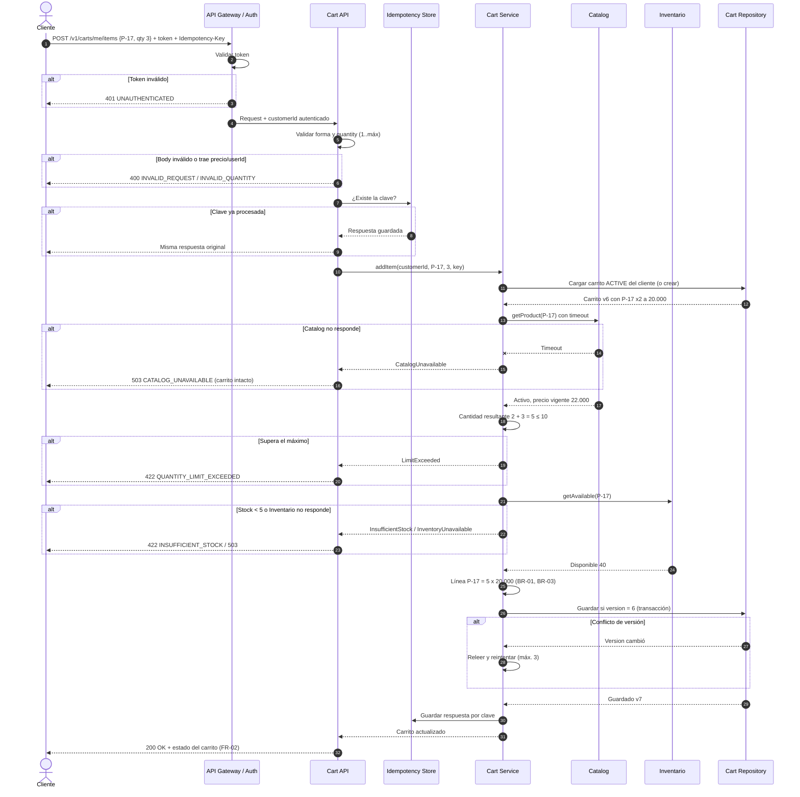

# Diseño candidato: Añadir ítem al carrito

Oct 21, 2026 · @Juan

## Contexto y alcance

Este diseño propone cómo implementar la operación **Añadir ítem al carrito** cumpliendo las nueve reglas aprobadas (FR-01, FR-02, BR-01 a BR-03, FC-01, INV-01, SEC-01, SEC-02). El ejemplo de referencia es el producto **P-17**, con precio unitario de **20.000 COP**.

Queda dentro del alcance: añadir un producto nuevo o sumar cantidad a una línea existente, validaciones previas, persistencia y respuesta. Quedan fuera: checkout, reserva de inventario, pagos, promociones, y las operaciones de disminuir o eliminar líneas.

El diseño es candidato: donde una regla no existe, se toma un supuesto explícito (sección siguiente) para poder avanzar, y se marca como decisión pendiente del negocio.

## Hechos confirmados, supuestos y preguntas abiertas

Solo lo que está en la tabla aprobada es un hecho. Todo lo demás en este diseño se apoya en un supuesto con ID, para que cada decisión sea rastreable y reversible.

### Hechos confirmados

| ID | Hecho | Fuente |
| --- | --- | --- |
| H-01 | El cliente puede añadir un producto a un carrito activo. | FR-01 |
| H-02 | En caso de éxito se devuelve el estado actualizado del carrito. | FR-02 |
| H-03 | Añadir un producto ya existente incrementa la cantidad de su línea. | BR-01 |
| H-04 | Un producto tiene como máximo una línea por carrito. | BR-02 |
| H-05 | Al incrementar una línea existente se conserva su unitPrice acordado. | BR-03 |
| H-06 | Si Catalog no está disponible antes de mutar, el carrito no cambia. | FC-01 |
| H-07 | Un CartItem persistido tiene cantidad mayor que cero. | INV-01 |
| H-08 | La identidad autenticada determina qué carrito se modifica; un userId enviado por el cliente no autoriza. | SEC-01 |
| H-09 | Un precio enviado por el cliente no es autoritativo. | SEC-02 |
| H-10 | P-17 existe y su precio unitario es 20.000 COP. | Usuario |

### Supuestos de trabajo

| ID | Supuesto | Por qué se asume | Impacto si es falso |
| --- | --- | --- | --- |
| S-01 | Cada cliente tiene como máximo un carrito ACTIVE; si no existe, se crea al primer añadido. | FR-01 exige carrito activo pero no dice cómo nace. | Cambia el contrato: habría que enviar cartId o devolver error si no hay carrito. |
| S-02 | La cantidad solicitada debe ser un entero entre 1 y el máximo por línea. | INV-01 solo protege lo persistido. | Pocos: solo se relaja la validación. |
| S-03 | Máximo por línea: 10 unidades (valor provisional). | No hay regla aprobada. | Se ajusta una constante de configuración. |
| S-04 | Superar el máximo rechaza la operación completa; no se recorta. | Coherente con FC-01: ante falla, carrito intacto. | Si se prefiere recortar, la respuesta debe incluir advertencias. |
| S-05 | La disponibilidad se verifica sin reservar al añadir; la reserva ocurre en checkout. | Reservar desde el carrito favorece acaparamiento. | Si se reserva aquí, se necesita expiración de reservas. |
| S-06 | Si Inventario no responde, el carrito no cambia (igual que FC-01). | Extiende FC-01 a la otra dependencia. | Si se elige fail-open, se pueden vender unidades sin stock. |
| S-07 | El unitPrice de una línea nueva se toma de Catalog en ese momento; el request no lleva precio. | Deriva de SEC-02. | Ninguno razonable: es la opción segura. |
| S-08 | Montos en COP como enteros, sin decimales; el precio de Catalog ya incluye IVA. | No está definido. | Cambia el cálculo de totales y lo que se muestra. |
| S-09 | El precio acordado no expira dentro de este diseño. | BR-03 no define vigencia. | Ver P-03: puede requerir revalidación. |
| S-10 | Solo clientes autenticados en esta versión; sin carritos de invitado. | SEC-01 habla de identidad autenticada. | Requiere identidad de invitado y fusión al iniciar sesión. |

### Preguntas abiertas

| ID | Pregunta | Quién decide | Afecta |
| --- | --- | --- | --- |
| P-01 | ¿Cuál es el máximo real por línea, y es por producto o global? | Negocio | S-03 |
| P-02 | Al superar el máximo, ¿rechazar o recortar al máximo? | Negocio / UX | S-04 |
| P-03 | ¿Cuánto dura el precio acordado de BR-03? ¿Se respeta si el precio baja? | Negocio / Legal | S-09 |
| P-04 | ¿Cuándo expira un carrito inactivo y qué estado toma? | Negocio | S-01 |
| P-05 | ¿Inventario fail-closed o fail-open si no responde? | Negocio / Operaciones | S-06 |
| P-06 | ¿Existen carritos de invitado y cómo se fusionan? | Producto | S-10 |
| P-07 | ¿Los 20.000 COP de P-17 incluyen IVA? | Contabilidad / Legal | S-08 |
| P-08 | ¿P-17 es un SKU final o tiene variantes (talla, color)? | Producto | BR-02 |
| P-09 | ¿Cuál es el timeout aceptable para Catalog e Inventario? | Arquitectura | FC-01, S-06 |
| P-10 | ¿Qué contiene exactamente el "estado actualizado" de FR-02? | Producto / Frontend | Contrato de respuesta |

## Componentes y responsabilidades

La regla de diseño central: **el Cart Service es el único que decide y muta el carrito**; Catalog e Inventario solo informan. Así toda la lógica de BR-01 a BR-03 e INV-01 vive en un solo lugar.

| Componente | Responsabilidad | No hace | Reglas que sostiene |
| --- | --- | --- | --- |
| API Gateway / Auth | Valida el token y entrega al servicio el customerId autenticado. Rechaza peticiones sin identidad válida. | No decide sobre carritos ni ignora el token por un userId del body. | SEC-01 |
| Cart API (controlador) | Valida forma del request (productId, quantity, Idempotency-Key). Traduce resultados a códigos HTTP. | No contiene reglas de negocio ni acepta precio. | S-02, SEC-02 |
| Cart Service (dominio) | Orquesta: obtiene carrito activo del cliente, consulta Catalog e Inventario, aplica fusión de línea, límites e invariantes, y persiste de forma atómica. | No calcula precios propios ni reserva stock. | FR-01, BR-01, BR-02, BR-03, INV-01, FC-01 |
| Cart (agregado) | Encapsula líneas y reglas: `addOrIncrement(productId, qty, catalogPrice)`. Rechaza estados inválidos. | No conoce HTTP ni servicios externos. | BR-01, BR-02, BR-03, INV-01 |
| Catalog Client | Devuelve si el producto existe, está activo y su precio vigente. Aplica timeout y circuit breaker. | No cachea precios para mutación más allá de lo acordado. | FC-01, SEC-02 |
| Inventory Client | Devuelve stock disponible (consulta sin reserva). Aplica timeout. | No reserva unidades. | S-05, S-06 |
| Cart Repository | Lee y guarda el carrito en una transacción con versión optimista. Restricción única (cartId, productId) y CHECK quantity > 0 en base de datos. | No aplica reglas de negocio más allá de las restricciones. | BR-02, INV-01 |
| Idempotency Store | Guarda la respuesta de cada Idempotency-Key por un tiempo limitado (ej. 24 h). | No interpreta el contenido. | Evita doble suma por reintentos (BR-01) |

Las restricciones de base de datos son la última defensa: aunque haya un error en el código, la base de datos impide dos líneas del mismo producto o cantidades en cero.

## Contrato de interfaz: AddItem

`POST /v1/carts/me/items` añade un producto al carrito activo del cliente autenticado, o suma cantidad a su línea existente. Garantía principal: **cualquier respuesta distinta de 200/201 deja el carrito exactamente como estaba.**

### Inputs

| Campo | Ubicación | Tipo | Obligatorio | Regla |
| --- | --- | --- | --- | --- |
| Authorization | Header | Bearer token | Sí | Única fuente del customerId (SEC-01). |
| Idempotency-Key | Header | UUID | Sí | Misma clave + mismo body = misma respuesta, sin volver a sumar. |
| productId | Body | string | Sí | Debe existir y estar activo en Catalog. |
| quantity | Body | entero | Sí | 1 ≤ quantity ≤ máximo por línea (S-02, S-03). |

El body **no acepta** `userId`, `cartId`, `unitPrice` ni `price`. Si llegan, la petición se rechaza con 400 para que el error del cliente sea visible (SEC-01, SEC-02).

```json
{ "productId": "P-17", "quantity": 2 }
```

### Outcomes exitosos

| Caso | HTTP | Efecto |
| --- | --- | --- |
| El producto no estaba en el carrito | 201 Created | Nueva línea con unitPrice tomado de Catalog en ese momento. |
| El producto ya tenía línea | 200 OK | Se suma la cantidad; el unitPrice de la línea no cambia (BR-01, BR-03). |
| Reintento con la misma Idempotency-Key | Igual a la original | Se devuelve la respuesta guardada; el carrito no cambia. |

Ejemplo con P-17: carrito vacío, se añaden 2 unidades → una línea de 2 × 20.000 = **40.000 COP**. Luego Catalog sube P-17 a 22.000 y se añaden 3 más → la misma línea queda en 5 × 20.000 = **100.000 COP**, por BR-03.

```json
{
  "cartId": "c-8f21",
  "status": "ACTIVE",
  "version": 7,
  "currency": "COP",
  "lines": [
    { "productId": "P-17", "quantity": 5, "unitPrice": 20000, "lineTotal": 100000 }
  ],
  "subtotal": 100000,
  "itemCount": 5,
  "warnings": [
    { "code": "PRICE_DIFFERS_FROM_CATALOG", "productId": "P-17", "catalogPrice": 22000 }
  ]
}
```

El campo `warnings` es opcional y no cambia el resultado; sirve para que el frontend informe diferencias de precio o stock bajo (P-10).

### Comportamiento erróneo

Los errores usan formato Problem Details (RFC 9457) con un `code` estable que el frontend puede interpretar.

| HTTP | code | Cuándo | Detalle devuelto | ¿Reintentar? |
| --- | --- | --- | --- | --- |
| 400 | INVALID\_REQUEST | Falta un campo, JSON inválido o llegan campos prohibidos (precio, userId). | Campo culpable | No |
| 400 | INVALID\_QUANTITY | quantity es 0, negativa, decimal o mayor que el máximo por línea. | min, max | No |
| 401 | UNAUTHENTICATED | Token ausente, inválido o vencido. | — | Tras reautenticar |
| 404 | PRODUCT\_NOT\_FOUND | Catalog no conoce el productId. | productId | No |
| 409 | CART\_NOT\_MODIFIABLE | El carrito está en checkout o cerrado. | status | No |
| 409 | CONCURRENT\_MODIFICATION | Otra escritura ganó y se agotaron los reintentos internos. | version actual | Sí |
| 409 | IDEMPOTENCY\_KEY\_REUSED | Misma clave con un body distinto. | — | No, con otra clave |
| 422 | PRODUCT\_NOT\_AVAILABLE | El producto existe pero está inactivo o descontinuado. | productId | No |
| 422 | QUANTITY\_LIMIT\_EXCEEDED | La cantidad resultante supera el máximo (ej. 8 en carrito + 5 > 10). | current, requested, max | No |
| 422 | INSUFFICIENT\_STOCK | La cantidad resultante supera el stock disponible. | requested, available | No |
| 503 | CATALOG\_UNAVAILABLE | Catalog no responde o excede el timeout (FC-01). | Retry-After | Sí |
| 503 | INVENTORY\_UNAVAILABLE | Inventario no responde (S-06). | Retry-After | Sí |
| 500 | INTERNAL\_ERROR | Falla inesperada; la transacción se revierte. | traceId | Sí, con la misma clave |

### Orden de validación

1. Autenticación y forma del request (rápido, sin llamadas externas).
2. Idempotencia: si la clave ya existe, devolver la respuesta guardada.
3. Cargar o crear el carrito activo del cliente.
4. Consultar Catalog: existencia, estado activo y precio vigente.
5. Calcular la cantidad resultante y validar el máximo por línea.
6. Consultar Inventario contra la cantidad resultante.
7. Persistir en una transacción con chequeo de versión; guardar la respuesta idempotente.

La cantidad resultante (no la solicitada) es la que se valida en los pasos 5 y 6, porque BR-01 hace que añadir sea acumulativo.

## Secuencia

El carrito solo se escribe en el último paso; cualquier falla anterior termina sin tocarlo, lo que cumple FC-01 y S-06 por construcción.



El ejemplo usa el caso de BR-03: Catalog ya marca 22.000, pero la línea existente conserva 20.000.

## Alternativas y tradeoffs

Cada decisión del diseño tiene una alternativa razonable. La opción elegida prioriza que el carrito nunca quede en un estado inconsistente, aunque cueste algo de experiencia de usuario o latencia.

| Decisión | Elegida | Alternativa | Qué se gana con la elegida | Qué se pierde |
| --- | --- | --- | --- | --- |
| D-01 Superar el máximo | Rechazar toda la operación | Recortar al máximo y advertir | Resultado predecible; coherente con FC-01. | El cliente debe reintentar con otra cantidad. |
| D-02 Stock al añadir | Verificar sin reservar | Reservar al añadir · No verificar | Sin acaparamiento ni expiración de reservas. | El stock puede agotarse antes del checkout; se revalida allí. |
| D-03 Concurrencia | Bloqueo optimista con versión + reintento | Bloqueo pesimista (SELECT FOR UPDATE) · Upsert atómico en SQL | Sin bloqueos largos mientras se llama a Catalog e Inventario. | Reintentos bajo alta contención; posible 409 al cliente. |
| D-04 Precio de Catalog | Consulta síncrona en cada añadido | Réplica o caché local de precios | Precio siempre vigente; FC-01 se aplica literalmente. | Latencia y dependencia en línea de Catalog. |
| D-05 Reintentos del cliente | Idempotency-Key en POST incremental | PUT con cantidad absoluta | Respeta la semántica de BR-01 (añadir = sumar). | Requiere almacenar claves y respuestas. |
| D-06 Campos prohibidos | Rechazar con 400 | Ignorar en silencio | Errores del cliente visibles; refuerza SEC-02. | Clientes antiguos que envían precio fallan. |
| D-07 Creación de carrito | Implícita al primer añadido | Endpoint explícito para crear | Un paso menos para el cliente. | Menos control si el negocio quiere varios carritos. |
| D-08 Ubicación de reglas | Agregado Cart + restricciones en BD | Solo en el servicio | Doble defensa para BR-02 e INV-01. | Reglas expresadas en dos lugares. |

Notas sobre las alternativas más tentadoras:

- **Upsert atómico (D-03)** es lo más simple para BR-01 y BR-02, pero el límite y el stock dependen de la cantidad resultante. Se puede incluir el límite en la condición del UPDATE, pero el stock viene de otro servicio, así que no elimina la necesidad de una lectura previa.
- **Caché de precios (D-04)** es razonable si Catalog es lento. Si se adopta, hay que definir su vigencia máxima y qué significa "Catalog no disponible" para FC-01.
- **PUT con cantidad absoluta (D-05)** es una buena operación complementaria para la pantalla del carrito ("poner 5 unidades"), pero no reemplaza a "añadir" desde el detalle del producto.

## Trazabilidad con las reglas aprobadas

Las nueve reglas quedan cubiertas, cada una con un mecanismo y una prueba sugerida con P-17.

| Regla | Mecanismo en el diseño | Prueba sugerida |
| --- | --- | --- |
| FR-01 | Endpoint AddItem sobre el carrito ACTIVE del cliente. | Añadir 2 de P-17 a carrito vacío → 201 con una línea. |
| FR-02 | Respuesta 200/201 con líneas, subtotal y versión. | Verificar que la respuesta refleja la línea y el subtotal 40.000. |
| BR-01 | `Cart.addOrIncrement` suma a la línea existente. | Con 2 en carrito, añadir 3 → cantidad 5. |
| BR-02 | Agregado + restricción única (cartId, productId). | Dos añadidos concurrentes de P-17 → una sola línea con la suma. |
| BR-03 | Al incrementar no se lee el precio de Catalog para la línea. | Catalog a 22.000, añadir 3 → unitPrice sigue en 20.000. |
| FC-01 | Catalog se consulta antes de cualquier escritura; timeout → 503. | Simular caída de Catalog → 503 y carrito con la misma versión. |
| INV-01 | Validación quantity ≥ 1 + CHECK quantity > 0 en BD. | Enviar quantity 0 o -1 → 400 y nada persistido. |
| SEC-01 | customerId solo del token; body con userId → 400. | Token de cliente A con userId de B → 400, carrito de B intacto. |
| SEC-02 | El request no acepta precio; unitPrice viene de Catalog. | Enviar price 1 → 400; sin precio → línea a 20.000. |

Antes de implementar conviene cerrar P-01 a P-05: cambian validaciones del contrato y casos de prueba, no la estructura de componentes.
