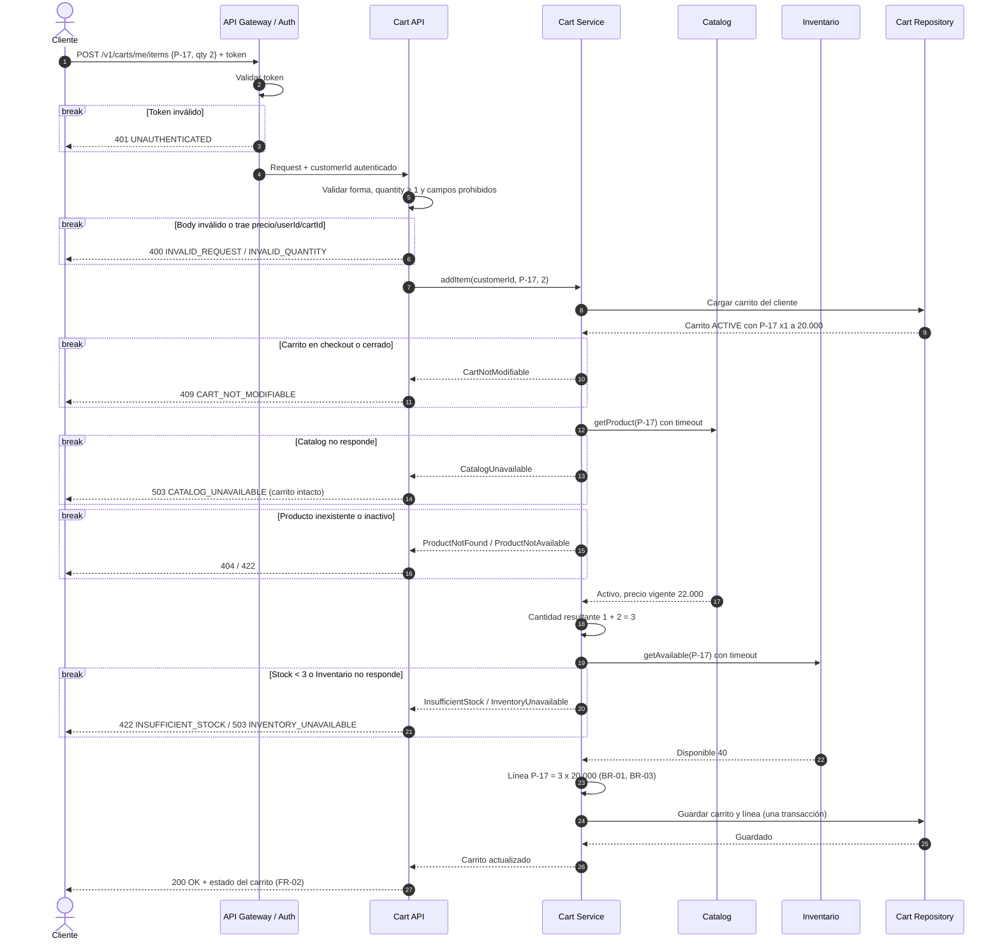

# Diseño candidato: Añadir ítem al carrito (v2)

Oct 22, 2026 · @Juan · Versión 2, refinada por el equipo a partir de la versión 1 generada con IA

## Contexto y alcance

Este diseño propone cómo implementar la operación **Añadir ítem al carrito** cumpliendo las nueve reglas aprobadas (FR-01, FR-02, BR-01 a BR-03, FC-01, INV-01, SEC-01, SEC-02) de la guía de la Clase 15.

**Escenario base aprobado:** un cliente autenticado tiene un carrito activo con el producto **P-17**, cantidad **1**, a un unitPrice acordado de **20.000 COP**. El cliente añade **2** unidades. Catalog reporta actualmente **22.000 COP**. No hay solicitudes concurrentes.

**Resultado esperado:** una sola línea de P-17 con cantidad **3** y unitPrice **20.000 COP**. Si Catalog no está disponible antes de mutar, el carrito queda sin cambios.

Queda dentro del alcance: añadir un producto nuevo o sumar cantidad a una línea existente, validaciones previas, persistencia y respuesta. Quedan fuera: checkout, reserva de inventario, pagos, promociones, operaciones de disminuir o eliminar líneas, expiración de carritos, y el manejo de solicitudes concurrentes o reintentos (ver "Trabajo futuro").

El diseño es candidato: donde una regla no existe se toma un supuesto explícito o una decisión del equipo, y se marca como pendiente de aprobación del negocio.

## Cambios respecto a la versión 1

| ID | Cambio | Motivo |
| --- | --- | --- |
| C-01 | El ejemplo pasa a ser el escenario base (1 + 2 = 3 a 20.000, Catalog en 22.000). | La v1 usaba un escenario propio (carrito vacío, 2 + 3 = 5) porque el prompt inicial no incluía el escenario base. |
| C-02 | H-10 corregido: 20.000 es el precio acordado de la línea; 22.000 es el precio actual en Catalog. | La v1 trataba 20.000 como precio del producto, lo que contradice BR-03. |
| C-03 | Se elimina el máximo por línea del contrato (código QUANTITY\_LIMIT\_EXCEEDED); queda como pregunta abierta. | La guía lo marca como no decidido (DE-01). |
| C-04 | Validación de inventario fail-closed, marcada como política propuesta por el equipo pendiente de aprobación. | La guía lo marca como no decidido (DE-02). |
| C-05 | Creación implícita del carrito solo si el cliente no tiene ninguno; si está en checkout o cerrado, 409. | Resuelve el conflicto entre S-01 y CART\_NOT\_MODIFIABLE (DE-03). |
| C-06 | Se retiran Idempotency-Key, Idempotency Store, bloqueo optimista y sus códigos de error. | La guía excluye la concurrencia; además la v1 se contradecía sobre cuándo se guardaba la respuesta idempotente (DE-04). |
| C-07 | El carrito nuevo se crea en la misma transacción que la línea, no antes de consultar Catalog. | En la v1, una falla de Catalog podía dejar un carrito vacío creado, en tensión con FC-01. |
| C-08 | El diagrama usa bloques `break` para los errores. | En la v1, los bloques `alt` sin `else` hacían ver que el flujo continuaba tras un error. |

## Hechos confirmados, supuestos y preguntas abiertas

Solo lo que está en la guía aprobada es un hecho. Todo lo demás se apoya en un supuesto o una decisión del equipo con ID, para que cada decisión sea rastreable y reversible.

### Hechos confirmados

| ID | Hecho | Fuente |
| --- | --- | --- |
| H-01 | El cliente puede añadir un producto a un carrito activo. | FR-01 |
| H-02 | En caso de éxito se devuelve el estado actualizado del carrito. | FR-02 |
| H-03 | Añadir un producto ya existente incrementa la cantidad de su línea. | BR-01 |
| H-04 | Un producto tiene como máximo una línea por carrito. | BR-02 |
| H-05 | Al incrementar una línea existente se conserva su unitPrice acordado. | BR-03 |
| H-06 | Si Catalog no está disponible antes de mutar, el carrito no cambia. | FC-01 |
| H-07 | Un CartItem persistido tiene cantidad mayor que cero. | INV-01 |
| H-08 | La identidad autenticada determina qué carrito se modifica; un userId enviado por el cliente no autoriza. | SEC-01 |
| H-09 | Un precio enviado por el cliente no es autoritativo. | SEC-02 |
| H-10 | En el escenario base, el carrito tiene P-17 × 1 a un unitPrice acordado de 20.000 COP, y Catalog reporta actualmente 22.000 COP. | Guía, escenario base |
| H-11 | Resultado esperado al añadir 2: una línea de P-17 con cantidad 3 y unitPrice 20.000 COP. | Guía, resultado esperado |
| H-12 | El ejercicio asume que no hay solicitudes concurrentes. | Guía, escenario base |
| H-13 | Validación de inventario, cantidad máxima y expiración del carrito no están decididas. | Guía, "Not yet decided" |

### Decisiones del equipo

Son decisiones tomadas por el equipo sobre temas que la guía deja abiertos o que la v1 propuso. Las marcadas como "Pendiente de negocio" son propuestas y no reemplazan una aprobación.

| ID | Decisión | Justificación | Estado |
| --- | --- | --- | --- |
| DE-01 | No se fija un máximo por línea en el contrato. Se deja un punto de extensión configurable sin activar. | H-13: el máximo no está decidido; fijar 10 sería aprobar una política en silencio. | Pregunta abierta (P-01, P-02) |
| DE-02 | Inventario se consulta al añadir, sin reservar, en modo fail-closed: sin stock suficiente o sin respuesta, el carrito no cambia. | Evita que el cliente acumule en el carrito unidades que no existen; extiende la garantía de FC-01 a la otra dependencia. | Pendiente de negocio (P-05) |
| DE-03 | Si el cliente no tiene ningún carrito, se crea uno ACTIVE al primer añadido. Si tiene uno en checkout o cerrado, se responde 409 y no se crea otro. | Es el comportamiento esperado en e-commerce; la condición evita que el cliente quede con dos carritos. | Decisión del equipo; fuera del escenario base |
| DE-04 | Concurrencia, reintentos e idempotencia quedan fuera de alcance. Se mantienen las restricciones de base de datos. | H-12 excluye la concurrencia. | Trabajo futuro (P-11) |
| DE-05 | Si el body trae userId, cartId, unitPrice o price, se rechaza con 400. | Hace visible el error del cliente. Es más estricto que SEC-02, que permite verificar en servidor, pero compatible con él. | Aceptada |
| DE-06 | La respuesta puede incluir `warnings` opcionales, por ejemplo PRICE\_DIFFERS\_FROM\_CATALOG. | No cambia el resultado y ayuda a explicar BR-03 en la interfaz. | Aceptada; contenido final depende de P-10 |

### Supuestos de trabajo

Se conservan los IDs de la v1 para mantener la trazabilidad; los supuestos retirados se indican.

| ID | Supuesto | Por qué se asume | Impacto si es falso |
| --- | --- | --- | --- |
| S-01 | Cada cliente tiene como máximo un carrito ACTIVE; si no tiene ninguno, se crea al primer añadido (DE-03). | FR-01 exige carrito activo pero no dice cómo nace. | Habría que crear el carrito en otro flujo y responder 409 si no existe. |
| S-02 | La cantidad solicitada debe ser un entero mayor o igual a 1. | INV-01 solo protege lo persistido; una cantidad 0 o negativa no tiene sentido al añadir. | Pocos: solo se relaja la validación. |
| S-03 | *Retirado.* Máximo provisional de 10 unidades. | Reemplazado por DE-01 y P-01. | — |
| S-04 | *Retirado.* Superar el máximo rechaza la operación. | Depende de P-01 y P-02. | — |
| S-05 | La disponibilidad se verifica sin reservar; la reserva ocurre en checkout (DE-02). | Reservar desde el carrito favorece el acaparamiento. | Si se reserva aquí, se necesita expiración de reservas. |
| S-06 | Si Inventario no responde, el carrito no cambia (DE-02). | Extiende FC-01 a la otra dependencia. | Si el negocio elige fail-open, se pueden añadir unidades sin stock y se debe advertir al cliente. |
| S-07 | El unitPrice de una línea nueva se toma de Catalog en ese momento; el request no lleva precio. | Deriva de SEC-02. | Ninguno razonable: es la opción segura. |
| S-08 | Montos en COP como enteros, sin decimales. | No está definido. | Cambia el cálculo y la presentación de totales. |
| S-09 | El precio acordado no expira dentro de este diseño. | BR-03 no define vigencia. | Ver P-03: puede requerir revalidación. |
| S-10 | Solo clientes autenticados en esta versión; sin carritos de invitado. | SEC-01 habla de identidad autenticada. | Requiere identidad de invitado y fusión al iniciar sesión. |

### Preguntas abiertas

| ID | Pregunta | Quién decide | Afecta |
| --- | --- | --- | --- |
| P-01 | ¿Existe un máximo por línea? ¿Cuál es, y es por producto o global? | Negocio | DE-01 |
| P-02 | Si existe un máximo, al superarlo ¿se rechaza o se recorta? | Negocio / UX | DE-01 |
| P-03 | ¿Cuánto dura el precio acordado de BR-03? ¿Se respeta si el precio de Catalog baja? | Negocio / Legal | S-09 |
| P-04 | ¿Cuándo expira un carrito inactivo y qué estado toma? | Negocio | S-01, DE-03 |
| P-05 | ¿Se aprueba validar inventario al añadir en modo fail-closed, o se prefiere fail-open o no validar? | Negocio / Operaciones | DE-02, S-05, S-06 |
| P-06 | ¿Existen carritos de invitado y cómo se fusionan? | Producto | S-10 |
| P-07 | ¿Los precios de Catalog incluyen IVA? | Contabilidad / Legal | S-08 |
| P-08 | ¿P-17 es un SKU final o tiene variantes (talla, color)? | Producto | BR-02 |
| P-09 | ¿Cuál es el timeout aceptable para Catalog e Inventario? | Arquitectura | FC-01, DE-02 |
| P-10 | ¿Qué contiene exactamente el "estado actualizado" de FR-02? ¿Se incluyen advertencias? | Producto / Frontend | Contrato de respuesta, DE-06 |
| P-11 | Cuando la concurrencia entre en alcance, ¿se usará Idempotency-Key, bloqueo optimista o upsert atómico? | Arquitectura | DE-04 |

## Componentes y responsabilidades

La regla de diseño central: **el Cart Service es el único que decide y muta el carrito**; Catalog e Inventario solo informan. Así toda la lógica de BR-01 a BR-03 e INV-01 vive en un solo lugar.

| Componente | Responsabilidad | No hace | Reglas que sostiene |
| --- | --- | --- | --- |
| API Gateway / Auth | Valida el token y entrega al servicio el customerId autenticado. Rechaza peticiones sin identidad válida. | No decide sobre carritos ni reemplaza el token por un userId del body. | SEC-01 |
| Cart API (controlador) | Valida la forma del request (productId, quantity) y rechaza campos prohibidos. Traduce resultados a códigos HTTP. | No contiene reglas de negocio ni acepta precio. | S-02, SEC-01, SEC-02, DE-05 |
| Cart Service (dominio) | Orquesta: obtiene el carrito del cliente, consulta Catalog e Inventario, aplica fusión de línea e invariantes, y persiste en una sola transacción. | No calcula precios propios ni reserva stock. | FR-01, FR-02, BR-01, BR-03, FC-01, DE-02, DE-03 |
| Cart (agregado) | Encapsula líneas y reglas: `addOrIncrement(productId, qty, catalogPrice)`. Rechaza estados inválidos. | No conoce HTTP ni servicios externos. | BR-01, BR-02, BR-03, INV-01 |
| Catalog Client | Devuelve si el producto existe, si está activo y su precio vigente. Aplica timeout. | No usa caché de precios (D-04). | FC-01, SEC-02 |
| Inventory Client | Devuelve el stock disponible (consulta sin reserva). Aplica timeout. | No reserva unidades. | DE-02, S-05, S-06 |
| Cart Repository | Lee y guarda el carrito y sus líneas en una transacción. Restricción única (cartId, productId) y CHECK quantity > 0 en base de datos. | No aplica reglas de negocio más allá de las restricciones. | BR-02, INV-01 |

Datos y propietarios: el **Cart** es dueño de las líneas, sus cantidades y el **precio acordado** de cada línea. **Catalog** es dueño del precio vigente y del estado del producto. **Inventario** es dueño del stock. El carrito nunca modifica datos de Catalog ni de Inventario.

Las restricciones de base de datos son la última defensa: aunque haya un error en el código, la base de datos impide dos líneas del mismo producto o cantidades en cero.

## Contrato de interfaz: AddItem

`POST /v1/carts/me/items` añade un producto al carrito activo del cliente autenticado, o suma cantidad a su línea existente. Garantía principal: **cualquier respuesta distinta de 200/201 deja el carrito exactamente como estaba.**

### Inputs

| Campo | Ubicación | Tipo | Obligatorio | Regla |
| --- | --- | --- | --- | --- |
| Authorization | Header | Bearer token | Sí | Única fuente del customerId (SEC-01). |
| productId | Body | string | Sí | Debe existir y estar activo en Catalog. |
| quantity | Body | entero | Sí | quantity ≥ 1 (S-02). Sin máximo mientras P-01 esté abierta (DE-01). |

El body **no acepta** `userId`, `cartId`, `unitPrice` ni `price`. Si llegan, la petición se rechaza con 400 para que el error del cliente sea visible (SEC-01, SEC-02, DE-05).

```json
{ "productId": "P-17", "quantity": 2 }
```

### Outcomes exitosos

| Caso | HTTP | Efecto |
| --- | --- | --- |
| El producto ya tenía línea (escenario base) | 200 OK | Se suma la cantidad; el unitPrice de la línea no cambia (BR-01, BR-03). |
| El producto no estaba en el carrito | 201 Created | Nueva línea con unitPrice tomado de Catalog en ese momento (S-07). |
| El cliente no tenía carrito | 201 Created | Se crea un carrito ACTIVE con la nueva línea, en la misma transacción (DE-03). |

Ejemplo del escenario base: el carrito tiene P-17 × 1 a 20.000. Catalog marca 22.000. Se añaden 2 → la misma línea queda en **3 × 20.000 = 60.000 COP**, por BR-01 y BR-03. Si P-17 no hubiera estado en el carrito, la nueva línea se crearía a 22.000, el precio vigente.

```json
{
  "cartId": "c-8f21",
  "status": "ACTIVE",
  "currency": "COP",
  "lines": [
    { "productId": "P-17", "quantity": 3, "unitPrice": 20000, "lineTotal": 60000 }
  ],
  "subtotal": 60000,
  "itemCount": 3,
  "warnings": [
    { "code": "PRICE_DIFFERS_FROM_CATALOG", "productId": "P-17", "catalogPrice": 22000 }
  ]
}
```

El campo `warnings` es opcional y no cambia el resultado; sirve para que el frontend informe diferencias de precio (DE-06, P-10).

### Comportamiento erróneo

Los errores usan formato Problem Details (RFC 9457) con un `code` estable que el frontend puede interpretar.

| HTTP | code | Cuándo | Detalle devuelto | ¿Reintentar? |
| --- | --- | --- | --- | --- |
| 400 | INVALID\_REQUEST | Falta un campo, JSON inválido o llegan campos prohibidos (precio, userId, cartId). | Campo culpable | No |
| 400 | INVALID\_QUANTITY | quantity es 0, negativa o decimal. | min | No |
| 401 | UNAUTHENTICATED | Token ausente, inválido o vencido. | — | Tras reautenticar |
| 404 | PRODUCT\_NOT\_FOUND | Catalog no conoce el productId. | productId | No |
| 409 | CART\_NOT\_MODIFIABLE | El carrito del cliente está en checkout o cerrado (DE-03). | status | No |
| 422 | PRODUCT\_NOT\_AVAILABLE | El producto existe pero está inactivo o descontinuado. | productId | No |
| 422 | INSUFFICIENT\_STOCK | La cantidad resultante supera el stock disponible (DE-02). | requested, available | No |
| 503 | CATALOG\_UNAVAILABLE | Catalog no responde o excede el timeout (FC-01). | Retry-After | Sí |
| 503 | INVENTORY\_UNAVAILABLE | Inventario no responde (DE-02, S-06). | Retry-After | Sí |
| 500 | INTERNAL\_ERROR | Falla inesperada; la transacción se revierte. | traceId | Sí, tras verificar el carrito (ver Trabajo futuro) |

### Orden de validación

1. Autenticación y forma del request (rápido, sin llamadas externas).
2. Cargar el carrito del cliente. Si está en checkout o cerrado → 409. Si no existe, se marca para crearlo al persistir.
3. Consultar Catalog: existencia, estado activo y precio vigente.
4. Calcular la cantidad resultante (cantidad actual + cantidad solicitada).
5. Consultar Inventario contra la cantidad resultante.
6. Persistir en una sola transacción: crear el carrito si hace falta y crear o actualizar la línea.

La cantidad resultante (no la solicitada) es la que se valida en el paso 5, porque BR-01 hace que añadir sea acumulativo. Si en el futuro se aprueba un máximo por línea (P-01), se valida en el paso 4.

## Secuencia

El carrito solo se escribe en el último paso; cualquier falla anterior termina sin tocarlo, lo que cumple FC-01 y DE-02 por construcción. Cada bloque `break` termina el flujo.



El ejemplo es el escenario base: Catalog marca 22.000, pero la línea existente conserva 20.000.

## Alternativas y tradeoffs

La opción elegida prioriza que el carrito nunca quede en un estado inconsistente, aunque cueste algo de experiencia de usuario o latencia.

| Decisión | Elegida | Alternativa | Qué se gana con la elegida | Qué se pierde |
| --- | --- | --- | --- | --- |
| D-01 Máximo por línea | Sin máximo hasta que decida el negocio (DE-01) | Límite provisional (rechazar o recortar) | No se aprueba una política en silencio. | Un cliente puede añadir cantidades poco realistas hasta que se defina P-01. |
| D-02 Stock al añadir | Verificar sin reservar, fail-closed (DE-02) | No verificar · Verificar fail-open · Reservar al añadir | El carrito nunca contiene más unidades de las disponibles en ese momento. | Si Inventario se cae, no se puede añadir; el stock puede agotarse antes del checkout y se revalida allí. |
| D-03 Concurrencia | Fuera de alcance (DE-04) | Bloqueo optimista · Bloqueo pesimista · Upsert atómico | Diseño más simple, alineado con el escenario base. | Sin protección explícita ante dos añadidos simultáneos, salvo las restricciones de BD. |
| D-04 Precio de Catalog | Consulta síncrona en cada añadido | Réplica o caché local de precios | Precio siempre vigente; FC-01 se aplica literalmente. | Latencia y dependencia en línea de Catalog. |
| D-05 Reintentos del cliente | Fuera de alcance (DE-04) | Idempotency-Key · PUT con cantidad absoluta | Menos componentes en esta versión. | Un reintento tras un timeout de red puede sumar dos veces. |
| D-06 Campos prohibidos | Rechazar con 400 (DE-05) | Ignorar en silencio | Errores del cliente visibles; refuerza SEC-01 y SEC-02. | Clientes antiguos que envían precio fallan. |
| D-07 Creación de carrito | Implícita si no existe ninguno; 409 si está en checkout o cerrado (DE-03) | Exigir carrito existente · Endpoint explícito para crear | Un paso menos para el cliente, sin riesgo de dos carritos. | Menos control si el negocio quiere varios carritos. |
| D-08 Ubicación de reglas | Agregado Cart + restricciones en BD | Solo en el servicio | Doble defensa para BR-02 e INV-01. | Reglas expresadas en dos lugares. |

Notas sobre las alternativas más tentadoras:

- **Catalog cuando la línea ya existe (D-04).** Por BR-03, el precio de Catalog no se usa para una línea existente, así que podría parecer innecesario consultarlo. Se consulta igual porque hay que confirmar que el producto sigue activo, y porque FC-01 exige que el carrito no cambie si Catalog no está disponible.
- **Fail-open en inventario (D-02).** Da mejor experiencia cuando Inventario falla, pero permite añadir unidades sin stock. Si el negocio lo prefiere (P-05), basta con cambiar el paso 5 y añadir un warning.
- **Caché de precios (D-04).** Es razonable si Catalog es lento. Si se adopta, hay que definir su vigencia máxima y qué significa "Catalog no disponible" para FC-01.

## Trazabilidad con las reglas aprobadas

Las nueve reglas quedan cubiertas, cada una con un mecanismo y una prueba sugerida sobre el escenario base.

| Regla | Mecanismo en el diseño | Prueba sugerida |
| --- | --- | --- |
| FR-01 | Endpoint AddItem sobre el carrito ACTIVE del cliente. | Carrito con P-17 × 1, añadir 2 → 200. |
| FR-02 | Respuesta 200/201 con líneas, subtotal y estado. | La respuesta muestra P-17 × 3, unitPrice 20.000, subtotal 60.000. |
| BR-01 | `Cart.addOrIncrement` suma a la línea existente. | Con 1 en carrito, añadir 2 → cantidad 3. |
| BR-02 | Agregado + restricción única (cartId, productId). | Tras añadir P-17 existente, el carrito sigue teniendo una sola línea de P-17. |
| BR-03 | Al incrementar no se usa el precio de Catalog para la línea. | Catalog en 22.000, añadir 2 → unitPrice sigue en 20.000. |
| FC-01 | Catalog se consulta antes de cualquier escritura; timeout → 503. | Simular caída de Catalog → 503 y carrito con P-17 × 1 a 20.000. |
| INV-01 | Validación quantity ≥ 1 + CHECK quantity > 0 en BD. | Enviar quantity 0 o -1 → 400 y nada persistido. |
| SEC-01 | customerId solo del token; body con userId → 400. | Token de cliente A con userId de B → 400, carrito de B intacto. |
| SEC-02 | El request no acepta precio; unitPrice viene del carrito o de Catalog. | Enviar price 1 → 400; sin precio → la línea sigue a 20.000. |

## Trabajo futuro

Lo siguiente quedó fuera de alcance por DE-04 y debe retomarse antes de producción:

- **Reintentos e idempotencia.** Sin Idempotency-Key, un reintento después de un timeout de red puede sumar la cantidad dos veces. Si se adopta, la respuesta idempotente debe guardarse en la misma transacción que el carrito, y las respuestas 5xx no deben quedar guardadas con la clave.
- **Concurrencia.** Dos añadidos simultáneos del mismo producto pueden perder una actualización. Las opciones son bloqueo optimista con versión, bloqueo pesimista o upsert atómico (P-11).

Antes de implementar conviene cerrar P-01, P-04 y P-05: cambian validaciones del contrato y casos de prueba, no la estructura de componentes.
